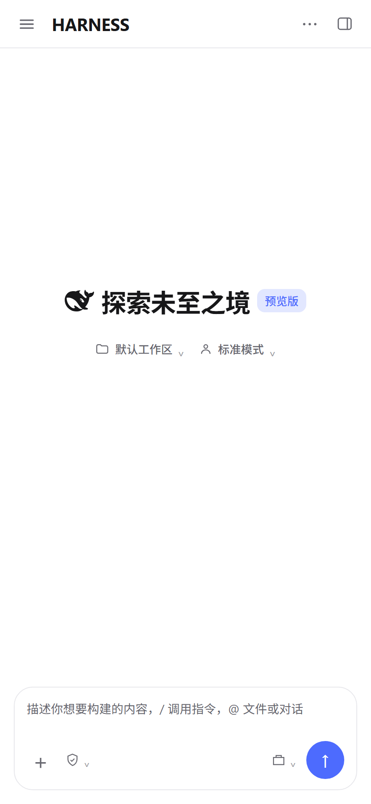
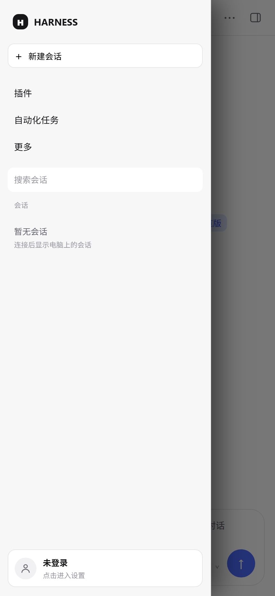
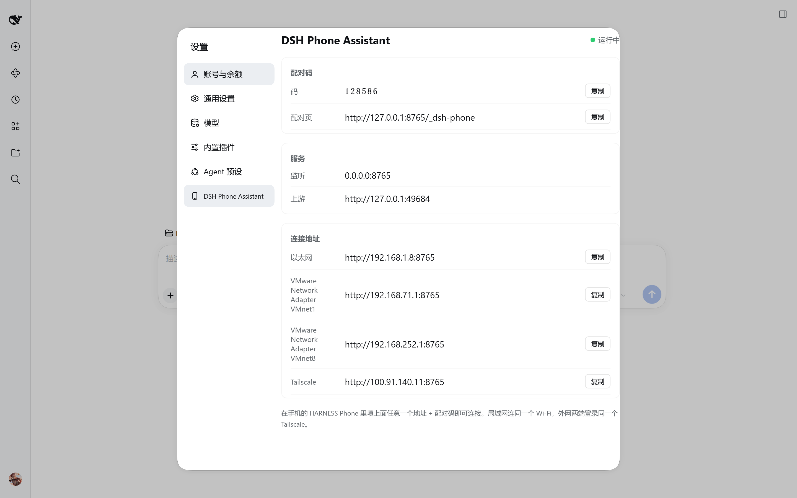
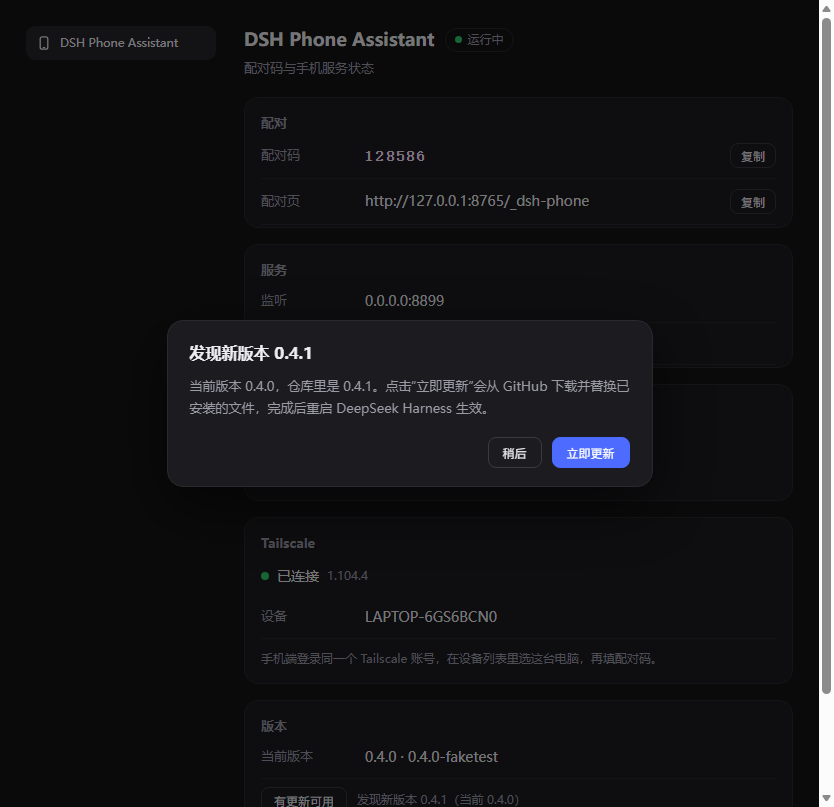

English | [中文](README.md)

# DSH Phone Bridge

Bridge the **DeepSeek Harness** running on your own computer to your phone: the phone is the screen and keyboard, the compute stays on the computer.

## First, what this is not: it is a bridge, not a phone build of DSH

**DSH keeps running on your computer. What the phone opens is that computer's UI.**

Model calls, file access and shell commands all happen on the computer; the
phone only renders the screen and sends input. Which means:

- **If the computer is off or offline, the phone cannot do anything** — it is a remote control, not a second DSH
- Sessions, workspaces, plugins and API keys stay on the computer; no copy is kept on the phone
- The phone does no heavy lifting, so even an old phone is fine

**Remote connection is supported.** You do not need to be on the same Wi-Fi:
phone on 4G/5G, computer at home — across cities and across carriers — as long
as both are signed in to the same Tailscale account and both are online.

The project itself **has no server**. The two ends try to connect peer-to-peer
first; when that fails (for example both sides behind strict NAT) Tailscale's
encrypted relay is the fallback, and the relay only forwards ciphertext.

## The project is split across two repositories

| Repository | Purpose |
|---|---|
| **[tihuzushi/dsh-phone-bridge](https://github.com/tihuzushi/dsh-phone-bridge)** ← this repository | The **plugin** installed into DSH on the computer: bridge service + mobile UI + pairing code / port settings |
| **[tihuzushi/dsh-phone-bridge-app](https://github.com/tihuzushi/dsh-phone-bridge-app)** | The **Android client** (APK): bundles user-space Tailscale via `tsnet`, so it does not occupy the system VPN |

📦 Phone APK

- **Short link (always the newest build)**: <https://www.hanhaichem.cn/dsh.apk>
- Direct link for this version (2.4.3): <https://www.hanhaichem.cn/wp-content/uploads/2026/11/DSH-Phone-Bridge-2.4.3.apk>
- GitHub Releases (often slow from mainland China): <https://github.com/tihuzushi/dsh-phone-bridge-app/releases/latest>

🎬 Author's Bilibili homepage

<https://space.bilibili.com/157183587>





---

## Setting Up from Scratch (Follow Along and It Works)

### Step 0: Prerequisites

| What you need | Notes |
|---|---|
| A Windows computer | DeepSeek Harness (DSH) installed, and its UI opens normally |
| An Android phone | Android 8.0 (API 26) or later |
| A Tailscale account | The free plan is enough; sign up at <https://login.tailscale.com/start> |

### Step 1: Install Tailscale on the computer (do this first)

1. Open <https://tailscale.com/download/windows> and download the installer
2. Sign in to your Tailscale account from the system tray, then click **Connect**
3. Confirm the status is Connected

> The phone ships its own Tailscale, but **the computer must also be in the same tailnet** for the phone to find it.

### Step 2: Install this plugin on the computer

In DSH: **设置 → 插件 → 添加插件** (Settings → Plugins → Add Plugin), enter:

```
https://github.com/tihuzushi/dsh-phone-bridge
```

It must be the full `https://` address (the input box does not accept the `github:user/repo` shorthand). **Restart DSH** after installing.

### Step 3: Confirm the plugin is up

**设置 → DSH Phone Assistant** (Settings → DSH Phone Assistant) should show:

- Status: **运行中** (Running, green dot)
- **配对码** (Pairing code): 6 digits, needed in the next step
- **Tailscale**: connected + your device name
- Service: listening on `0.0.0.0:8765`

If any of these is wrong:

| Symptom | What to do |
|---|---|
| Not running | The plugin did not start; restart DSH. If that does not help, check whether port 8765 is taken by another program |
| Tailscale red dot 「没有安装」 (Not installed) | Go back to Step 1 |
| Tailscale 「已安装，但没有连接」 (Installed, but not connected) | Open Tailscale on the computer and click Connect |

### Step 4: Install the app on the phone

1. Open <https://github.com/tihuzushi/dsh-phone-bridge-app/releases/latest>
2. Download `DSH-Phone-Bridge-<版本>.apk` and install it on the phone (allow 「安装未知来源应用」 (Install unknown apps))

### Step 5: Sign in to Tailscale on the phone

In the top-right corner of the app, open **连接设置** (Connection Settings) → 「打开 Tailscale 登录页」 (Open Tailscale sign-in page) → sign in to **the same account** in the browser → return to the app and wait for the status to change to 「已连接」 (Connected).

### Step 6: Pair

1. In the app's 「连接设备」 (Connect Device), select your computer (the list comes from your tailnet)
2. Enter the **6-digit pairing code** from Step 3
3. Tap 「保存并连接」 (Save and Connect)

Once connected, the DSH UI opens on the phone; the mobile layout is injected by this plugin.

### FAQ

| Symptom | Cause / what to do |
|---|---|
| The phone keeps flashing and never opens | The pairing code is wrong, and the app is retrying automatically. Check the current code on the computer's settings page; since plugin 0.4.5 a wrong code no longer locks you out |
| The device list is empty | Tailscale is not signed in on the phone, or the computer is not connected to the tailnet |
| Switched computers / reinstalled the plugin | The pairing code is regenerated; enter the new one |
| Want a different port | Change it in the 「端口」 (Port) card on the settings page, or tick 「被占用时自动换端口」 (auto-switch port when occupied) |

---

## What It Does

| Side | Role |
|---|---|
| **Host side** (`lib/index.js`) | Listens on `0.0.0.0:8765`, gives the phone a pairing entry point, forwards HTTP and WebSocket to DSH's own loopback port, and attaches a locally issued session cookie |
| **Client side** (`lib/client.js`) | Applies the mobile shell when the phone opens it: drawer sidebar, top-bar menu, inline buttons in panel page titles, file download and preview |

The DSH Web GUI only listens on `127.0.0.1`, so the phone (a different device) cannot reach it in the first place; this plugin is that channel.

## Settings Page



**设置 → DSH Phone Assistant** (Settings → DSH Phone Assistant) contains:

- **配对** (Pairing): pairing code, pairing page address, `重新生成配对码` (Regenerate Pairing Code), `配对重试节流` (Pairing Retry Throttle) toggle
- **服务** (Service): listen address, upstream DSH port
- **端口** (Port): change the port / auto-switch port when it is taken
- **Tailscale**: shows only this computer's device name, and checks in real time whether it is installed and connected; if it is not installed, a download button is shown right there
- **APP 客户端** (App client): button to download the phone APK, linking to [the App repository's Releases](https://github.com/tihuzushi/dsh-phone-bridge-app/releases/latest)
- **版本** (Version): current plugin version + **检查更新** (Check for Updates)

### When the Pairing Code Does Not Match

There is no cooldown lock anymore. A wrong code only lengthens the retry interval (starting at 1.5 seconds, up to 15 seconds); **the correct code goes through immediately at any time**.

- The phone reports 「配对尝试过多」 (Too many pairing attempts) → look at the current code on the computer's settings page
- Want a new code right away → click 「重新生成配对码」 (Regenerate Pairing Code) (this also clears the throttle state)
- Want to ignore throttling entirely → turn off the 「配对重试节流」 (Pairing Retry Throttle) toggle

## Updating the Plugin

At the very bottom of the settings page, 「版本 → 检查更新」 (Version → Check for Updates):

- Uses the GitHub API to get the repository HEAD commit, then reads `package.json` at that commit to compare versions (files are fetched by sha so CDN caching cannot mix old and new files)
- New version → a dialog shows the old and new version numbers; click 「立即更新」 (Update Now) to copy files such as `lib/index.js`, `lib/client.js` and `package.json` over the installed directory (backed up to the system temp directory before overwriting, with a full rollback on failure)
- Update finished → it prompts 「重启 DeepSeek Harness 即可完成更新」 (Restart DeepSeek Harness to complete the update)



The hot update only replaces files on disk; the new code runs only after you **restart DSH once**.

## Tailscale

The plugin listens on `0.0.0.0:8765`, which includes the Tailscale virtual adapter:

- After the computer signs in to Tailscale, the settings page shows the device name, and the startup log gains one more line: `Tailscale: http://100.x.x.x:8765`
- The phone and the computer only need to be in the same tailnet; the same Wi-Fi or the public internet both work
- The phone does **not need the Tailscale app** — the APK bundles `tsnet`, so signing in once inside the app is enough

## Configuration

State file: `~/.dsh/phone-bridge.json`

```json
{
  "port": 8765,
  "autoPort": true,
  "throttle": true,
  "pairingCode": "123456"
}
```

## Firewall

On first run Windows shows 「是否允许」 (Allow access); choose **专用网络** (Private networks) and allow it. If there is no prompt but you cannot connect, check port 8765 in the inbound rules.

## Uninstall

DSH → 插件 (Plugins) → 已安装插件 (Installed Plugins) → `dsh-phone-bridge` → 卸载 (Uninstall), then restart DSH.

## Related Repositories

- **[tihuzushi/dsh-phone-bridge](https://github.com/tihuzushi/dsh-phone-bridge)** — this repository: the DSH plugin for the computer
- **[tihuzushi/dsh-phone-bridge-app](https://github.com/tihuzushi/dsh-phone-bridge-app)** — the Android client source code and APK

## License

MIT, see [LICENSE](LICENSE).

This repository **contains no third-party code**: it uses only Node built-in modules and has no runtime dependencies. It runs on top of
DeepSeek Harness and calls the DSH plugin API (DSH itself is also MIT); it does not copy any
DSH source code.

The Android repository is different — its APK bundles Tailscale's binaries, and the license list is in
[dsh-phone-bridge-app/THIRD-PARTY-NOTICES.md](https://github.com/tihuzushi/dsh-phone-bridge-app/blob/main/THIRD-PARTY-NOTICES.md).

---

## Who Wrote This

Bilibili homepage

<https://space.bilibili.com/157183587>
