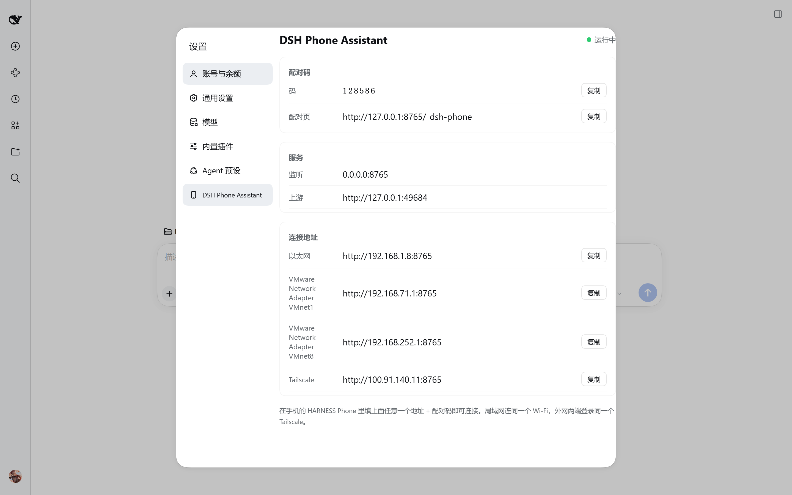

# dsh-phone-bridge

Phone access for [DeepSeek Harness](https://github.com/deepseek-ai/deepseek-harness), packaged as **one plugin**:
the bridge and the mobile shell UI live in the same DSH plugin, so there is no second process, no
`start-bridge.cmd` and no port scanning — the plugin runs inside the host and already knows which loopback
port the web GUI is on.

把「手机能连上电脑」和「手机上显示什么界面」合成一个 DSH 插件：装一次，重启 DSH，手机就能用。


## 它做了什么

| 半边 | 作用 |
|---|---|
| **宿主侧**（`lib/index.js`） | 在 `0.0.0.0:8765` 监听，给手机一个配对入口，把 HTTP 和 WebSocket 转发到 DSH 自己的回环端口，并附上本地签发的会话 cookie |
| **客户端侧**（`lib/client.js`） | 手机打开时套用移动端外壳：抽屉侧边栏、顶栏菜单、面板页标题内联按钮、文件下载与预览 |

DSH 的 Web GUI 只监听 `127.0.0.1`，手机（另一台设备）本来连不上；这个插件就是那条通道。

## 安装

在 HARNESS 的 **插件 → 添加插件** 里填：

```
https://github.com/tihuzushi/dsh-phone-bridge
```

支持 npm 包名、Git 仓库、本地目录三种方式。装完**重启 DSH**，它会出现在「已安装插件」里。

## 设置页

装好并重启后，HARNESS 的**设置**里会多出一栏 **DSH Phone Assistant**：显示配对码、监听地址、上游端口、各网卡（含 Tailscale）的连接地址，都带一键复制；右下角有服务状态（运行中 / 未运行）。



## 配对

重启后，在**电脑上**打开：

```
http://127.0.0.1:8765/_dsh-phone
```

页面会显示 6 位配对码和各网卡对应的地址（配对信息只在本机回环地址显示，局域网里的其他人看不到）。

手机 App 里填「地址 + 配对码」即可；也可以直接把 `http://<地址>:8765/pair?code=<配对码>` 发到手机上打开。

配对成功后手机会拿到一个 1 年有效的 cookie，之后不用再配。

## Tailscale

插件监听的是 `0.0.0.0:8765`，**包含 Tailscale 虚拟网卡**，所以：

- 电脑登录 Tailscale 后，启动日志里会多出一条 `Tailscale: http://100.x.x.x:8765/pair?code=...`
- 手机和电脑在同一个 tailnet 里，填这个 `100.x` 地址就能在外网用
- 手机端**不需要装 Tailscale App**——HARNESS Phone 的 APK 内置了 tsnet，在 App 里登录一次即可

局域网和 Tailscale 可以同时用，哪个通走哪个。

## 配置

状态文件：`~/.dsh/phone-bridge.json`

```json
{
  "port": 8765,
  "host": "0.0.0.0",
  "pairingCode": "123456"
}
```

- 改端口 / 换配对码：改完**重启 DSH**
- 想只给局域网用、不暴露到 Tailscale：把 `host` 改成具体网卡地址，比如 `192.168.1.10`

## 防火墙

首次运行时 Windows 会弹「是否允许」，选**专用网络**允许即可。没弹窗但连不上，检查入站规则里 8765 端口。

## 卸载

插件 → 已安装插件 → `dsh-phone-bridge` → 卸载，重启 DSH。
状态文件 `~/.dsh/phone-bridge.json` 可以留着（下次装回来还是同一个配对码），也可以删掉。

## 说明与限制

- 插件活在 DSH 进程里：**DSH 没运行就没有监听**，这是和独立桥接程序唯一的体验差别
- 如果 8765 被别的程序占用，插件只会在日志里报错、不会让 DSH 启动失败；改端口即可
- 界面适配 DSH 0.2.x，靠 DOM 选择器定位元素，DSH 大版本升级后可能需要跟进
- 手机端需要配套的 APK（`HARNESS Phone`），只装插件也可以在安卓浏览器里直接访问

## License

MIT，见 [LICENSE](LICENSE)。

社区项目，与 DeepSeek 官方无隶属关系；DeepSeek Harness 本身以 MIT 协议开源。
